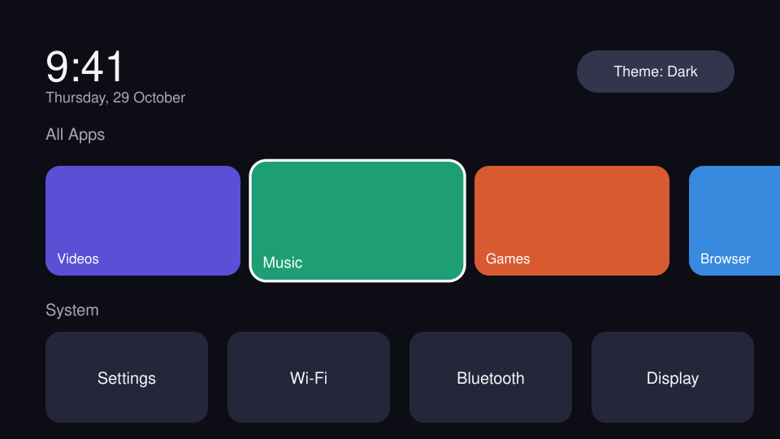
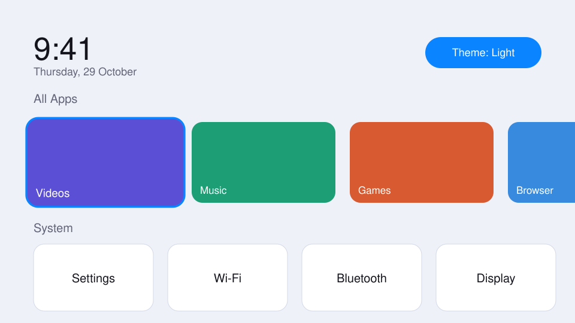

<div align="center">

# Aura Launcher

**A clean, Apple TV–inspired home screen for Android TV and Google TV.**

A simple, remote-friendly launcher with Dark, Light and Auto themes. No ads, analytics, or network permission.


-blue)


[Download the latest release](https://github.com/SKABDULAHMED8/AuraTVLauncher/releases/latest) · [Installation guide](docs/INSTALLATION.md) · [Changelog](CHANGELOG.md)

</div>

---

## Preview

| Dark theme | Light theme |
|:--:|:--:|
|  |  |

> **Preview note:** These are illustrative mockups, not photographs or captures from a running TV. The installed launcher displays apps available on your device. Real device screenshots can be added here as they become available.

## Features

| Feature | What it does |
|---|---|
| **Apple TV–inspired layout** | Large rounded app cards, a clock and date, and a visible focus state for remote navigation. |
| **Dark, Light and Auto themes** | Use the Theme control to cycle between the available themes. The choice is stored locally. |
| **Favorites** | Keep frequently used apps in a larger Favorites row. |
| **Installed apps** | Browse supported installed TV apps. TV apps can show their banners; other apps use icon tiles. |
| **System shortcuts** | Quick access to Settings, Wi-Fi, Bluetooth and Display where the TV firmware supports those screens. |
| **App list refresh** | The launcher responds to app installation, update and removal events. |
| **Remote-first navigation** | Designed for a D-pad, OK/Select and Back buttons. |
| **Local settings** | Theme and favorites are stored on the device. |
| **No network permission** | The app manifest does not request Internet access and the project does not include ad or analytics SDKs. |

## Remote control

| Remote button | Action |
|---|---|
| D-pad arrows | Move focus between controls and app cards |
| OK / Select | Open the focused app or control |
| Long-press OK, or Menu where supported | Open the app menu for supported actions such as favorites and app info |
| Focus Theme and press OK | Cycle Auto, Dark and Light |
| Back | Return to the launcher home screen |

Exact remote behavior can vary by TV manufacturer and remote model.

## Download Aura Launcher

1. Open the [GitHub Releases page](https://github.com/SKABDULAHMED8/AuraTVLauncher/releases).
2. Open the latest **published** release.
3. Download the APK asset, for example `AuraLauncher-v1.0.0.apk`.
4. Optionally download the accompanying `.apk.sha256` file to check the APK's SHA-256 hash.

Only install an APK from a release you trust. The release APK is signed with the project's permanent release key.

## Install on an Android TV

### Method A — USB drive and a TV file manager

1. Download the APK on a computer or phone.
2. Copy the APK to a USB drive, then connect it to the TV.
3. Open a file manager on the TV, such as CX File Explorer, and open the APK.
4. If Android asks, allow that file manager to **Install unknown apps**. The exact menu differs by Android version and TV brand.
5. Select **Install**, wait for completion, and open Aura Launcher from the TV's app list.

If the TV displays **App not installed**, see [Installation troubleshooting](docs/INSTALLATION.md#troubleshooting).

### Method B — Install with ADB (optional)

ADB requires debugging access on the TV. Some TV brands and custom interfaces, including some operator or CloudTV builds, may hide or disable these settings. Use the USB/file-manager method if ADB is unavailable.

On a computer with Android Platform Tools installed:

```powershell
adb connect TV_IP_ADDRESS:5555
adb install AuraLauncher-v1.0.0.apk
```

Replace `TV_IP_ADDRESS` with your TV's IP address. Use the actual port shown by the TV's debugging settings; do not assume port 5555 is enabled. Accept the authorization prompt on the TV if one appears.

## Set Aura Launcher as the Home app

Installing Aura Launcher does not guarantee that every TV will let it replace the manufacturer's home screen.

- On some Android TV devices, pressing **Home** opens an app chooser. Select Aura Launcher and choose **Always** if that option is available.
- On other devices, check the system's **Default apps**, **Home app**, or launcher settings.
- Some custom TV firmware does not expose a Home-app selector or Developer options. In that case, Aura Launcher may still be opened from the app list, but the stock Home button may continue to open the manufacturer's launcher.

Do not disable or remove the stock launcher unless you have confirmed that your TV provides another reliable way to reach a working Home app. Manufacturer-specific behavior can differ.

## Updating an existing installation

- Install future production updates from the GitHub Releases page.
- **Keep the permanent release signing key unchanged.** Updates signed with the same key can normally replace previous production releases without removing app data.
- Android does not normally allow an APK signed with a different certificate to update the installed app. For example, a release APK may not update a debug-signed test APK.
- If Android reports **App not installed** during an update, do not immediately uninstall the current app. Read the error and back up any important app data first. Uninstalling normally removes the app's private data and settings.

See the [installation and update guide](docs/INSTALLATION.md) for more detail.

## Build from source

### Requirements

- JDK 17
- Android SDK
- Gradle 8.10.2 (the GitHub Actions workflow uses this version)

### Build a debug APK

```bash
gradle assembleDebug
```

Output: `app/build/outputs/apk/debug/app-debug.apk`

Debug APKs are for development and testing. They are not the official production download.

### Build a signed release APK

Release signing uses environment variables supplied to Gradle by the release workflow. Do not commit a keystore or passwords to the repository.

The tag-triggered GitHub Actions workflow expects these repository secrets:

- `RELEASE_KEYSTORE_BASE64`
- `RELEASE_STORE_PASSWORD`
- `RELEASE_KEY_ALIAS`
- `RELEASE_KEY_PASSWORD`

To trigger a versioned release build, create and push a version tag only after the corresponding source is ready:

```bash
git tag v1.0.1
git push origin v1.0.1
```

The workflow builds the release APK, creates a SHA-256 checksum, and creates a **draft** GitHub Release. Review the draft and publish it when ready. Do not create a new version tag for the already-published `v1.0.0`.

## Project structure

```text
AuraTVLauncher/
├── app/src/main/
│   ├── AndroidManifest.xml
│   ├── java/com/auratv/launcher/
│   └── res/
├── docs/
│   ├── INSTALLATION.md
│   ├── preview-dark.svg
│   └── preview-light.svg
├── .github/workflows/build.yml
├── CHANGELOG.md
└── README.md
```

## Technical details

- **Language:** Kotlin 2.0
- **UI:** Jetpack Compose
- **Android Gradle Plugin:** 8.7
- **Gradle:** 8.10.2 in CI
- **Minimum SDK:** 24 (Android 7.0)
- **Target SDK:** 34
- **Application ID:** `com.auratv.launcher`

## Privacy

The Android manifest does not request the `INTERNET` permission. Theme and favorites are stored locally. The app requests `REQUEST_DELETE_PACKAGES` for its uninstall action. Review the source code and permissions yourself if you need to validate these claims for a particular build.

## Troubleshooting

| Problem | What to try |
|---|---|
| **App not installed** | Check whether the installed app was signed with a different key, confirm the APK download completed, and check the Android version. See the [troubleshooting guide](docs/INSTALLATION.md#troubleshooting). |
| **Home still opens the stock launcher** | Check whether your TV exposes a Home-app chooser or default launcher setting. Some custom firmware blocks this. |
| **An app is missing** | Some apps do not publish a launcher entry. Check the TV's app list and reopen Aura Launcher. |
| **A system shortcut does nothing** | The TV manufacturer may not provide that settings screen. Open the corresponding option through system Settings. |
| **Gradle build fails** | Check JDK 17, Android SDK installation, and the Gradle version. |

## Roadmap

Ideas under consideration:

- Custom wallpapers
- Reorder and hide apps
- Per-app row sorting

These are ideas, not promises or committed release dates.

## Contributing

Bug reports and pull requests are welcome. Include your TV brand/model, Android version (if known), what you expected, and the steps to reproduce the issue. Do not include passwords, signing keys, or other secrets in issues.

Please keep the project ad-free and network-free by default.
